# RetryRail — Complete Project Overview

> This document is a portable, detailed description of the RetryRail project.
> It is based on the implementation and evidence committed in this repository,
> together with the product requirements, build plan, and the four project
> overview documents supplied as writing examples. The example files are
> reference material for structure and detail only; their project-specific
> instructions, credentials, commands, assumptions, and claims do not apply to
> RetryRail.
>
> **Evidence date:** repository status records its latest verification on
> September 6, 2026. This overview does not imply that a new full verification
> was run while writing it. The system is scoped to synthetic data and
> Razorpay Test Mode; it does not process live money.

## Table of Contents

1. [Project at a glance](#1-project-at-a-glance)
2. [Problem and product thesis](#2-problem-and-product-thesis)
3. [Users and use cases](#3-users-and-use-cases)
4. [Product scope and explicit limits](#4-product-scope-and-explicit-limits)
5. [End-to-end workflow](#5-end-to-end-workflow)
6. [System architecture](#6-system-architecture)
7. [Technology stack](#7-technology-stack)
8. [Repository structure](#8-repository-structure)
9. [Backend implementation](#9-backend-implementation)
10. [Webhook, event, and projection pipeline](#10-webhook-event-and-projection-pipeline)
11. [Synthetic data and ground truth](#11-synthetic-data-and-ground-truth)
12. [Detector and diagnosis](#12-detector-and-diagnosis)
13. [AI incident analyst](#13-ai-incident-analyst)
14. [Policy, approval, and recovery execution](#14-policy-approval-and-recovery-execution)
15. [Razorpay Test Mode adapter](#15-razorpay-test-mode-adapter)
16. [Recovery experiment and impact measurement](#16-recovery-experiment-and-impact-measurement)
17. [Merchant web application](#17-merchant-web-application)
18. [HTTP API reference](#18-http-api-reference)
19. [Contracts and database](#19-contracts-and-database)
20. [Security, privacy, and authority boundaries](#20-security-privacy-and-authority-boundaries)
21. [Observability and operations](#21-observability-and-operations)
22. [Evaluation results and evidence](#22-evaluation-results-and-evidence)
23. [Milestone history and current status](#23-milestone-history-and-current-status)
24. [Local setup and commands](#24-local-setup-and-commands)
25. [Configuration reference](#25-configuration-reference)
26. [Deployment design](#26-deployment-design)
27. [Testing and release verification](#27-testing-and-release-verification)
28. [Known limitations and future work](#28-known-limitations-and-future-work)
29. [Buildathon mapping and demo narrative](#29-buildathon-mapping-and-demo-narrative)
30. [Key source files and evidence index](#30-key-source-files-and-evidence-index)

## Diagram index

| View | What it explains |
| --- | --- |
| [System map](#1-project-at-a-glance) | Product loop from verified events to measured incremental value |
| [System context](#system-context) | People and external systems around the RetryRail boundary |
| [Runtime topology](#detailed-runtime-topology) | Components, storage, optional model, provider, and measurement paths |
| [Event processing](#event-delivery-and-failure-paths) | Signature checks, durable write, retries, leases, dead letters, and ordering |
| [Detector and diagnosis](#detector-decision-path) | Qualification gates and the separation between facts, rules, and model advice |
| [Incident lifecycle](#incident-lifecycle) | The persisted open/resolved lifecycle and its healthy-window condition |
| [Approval and execution](#approval-and-provider-interaction-sequence) | Merchant review, transactional dispatch, one provider create, and lookup-only recovery |
| [Policy decision map](#policy-decision-map) | Authoritative facts, all-rule evaluation, approval, and revalidation |
| [Evidence lineage](#evidence-lineage-conceptual) | Logical event-to-action audit record relationships |
| [Impact experiment](#16-recovery-experiment-and-impact-measurement) | Frozen eligibility, assignment, attribution, and incremental-value calculation |
| [Merchant journey](#merchant-journey-map) | Screens and user-visible states from overview through impact report |
| [Trust boundaries](#trust-boundary-and-data-flow) | Data allowed across browser, API, model, database, and provider boundaries |
| [Deployment topology](#26-deployment-design) | Local Compose services and reviewer deployment components |
| [Release pipeline](#release-verification-pipeline) | Parallel CI gates, exact tested commit, and separate deployment boundary |

## 1. Project at a glance

| Item | Details |
| --- | --- |
| Project | **RetryRail** |
| Tagline | Revenue reliability, closed loop. |
| Submission concept | AI-powered payment reliability and revenue recovery |
| Program | Razorpay AI Buildathon, Track 3 — AI Revenue Recovery |
| Product category | Merchant payment-operations control plane |
| Primary outcome | Estimate incremental recovered gross merchandise value (GMV) from a bounded recovery workflow |
| Input | Razorpay-shaped payment events, deterministic synthetic fixtures, and frozen evaluation batches |
| Detection authority | Versioned statistical detector; never an LLM |
| Diagnosis | Deterministic, evidence-cited rules brief with optional constrained model explanation |
| Recovery action | One review-first Standard Payment Link plan for an eligible synthetic failed payment |
| Provider boundary | Deterministic fake by default; narrowly protected Razorpay Test Mode adapter |
| Measurement | Frozen treatment/control assignment, same-payment attribution, and uncertainty interval |
| Backend | Python 3.12, FastAPI, Pydantic, SQLAlchemy, Alembic, PostgreSQL |
| Frontend | React 18, TypeScript strict mode, Vite, Razorpay Blade |
| Local runtime | Docker Compose, PostgreSQL, API, worker, Vite; optional Prometheus/Grafana |
| Documented delivery status | M0–M8 complete; M9 reviewer deployment package rehearsed, with publication and final submission steps pending |

RetryRail is designed to demonstrate an evidence-backed loop, not simply to
display an alert or generate an AI summary:

```text
authenticate payment evidence
  → persist it durably
  → project payment state safely
  → detect merchant-local cohort degradation
  → explain what is known and uncertain
  → determine whether a bounded recovery is allowed
  → show the exact action for merchant approval
  → execute once through a constrained provider adapter
  → reconcile uncertain provider outcomes by lookup
  → verify the complete audit chain
  → estimate incremental recovered value against a holdout
```

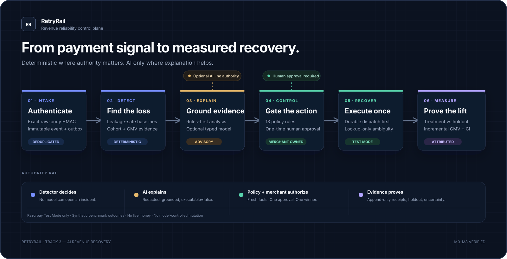

The following diagrams expand the system map into the concrete paths that
matter during operation. They are written as Mermaid in this Markdown file so
the source stays editable and the diagrams remain beside the explanation.

All synthetic measurements are labeled as such. One human-approved Razorpay
Test Mode Payment Link proves the external provider boundary; it does not
represent a real-money payment or live merchant recovery.

## 2. Problem and product thesis

Payment failures are often reviewed one transaction at a time. A merchant may
not notice that a particular payment method, issuer, error source, or payment
step has become materially less successful until the losses have accumulated.
Even after recognizing a pattern, an operations team must establish the likely
cause, identify safe candidates, decide whether a recovery action is permitted,
obtain approval, create an alternate payment path, and later determine whether
the intervention caused additional recoveries.

Simple approaches do not answer all of those questions:

- A raw percentage threshold can alert on tiny or noisy cohorts.
- A language model can describe a pattern without proving that it exists.
- A plausible explanation can overstate causality or ecosystem-wide impact.
- Retrying every failed payment may be unsafe, unwanted, or policy-violating.
- Counting every later success as recovered by the intervention ignores natural
  recovery that would have happened without it.
- A successful create response does not prove safety under duplicate requests,
  timeouts, process crashes, replay, or out-of-order webhooks.

RetryRail's thesis is that a merchant tool can connect **detection, evidence,
decision authority, bounded recovery, durable audit, and causal impact
measurement** while keeping each responsibility explicit. It is an operational
control plane, not a replacement payment router, payment processor, or general
purpose chatbot.

## 3. Users and use cases

### Primary user: merchant payment operations lead

Needs to identify a worsening payment cohort, see the size and evidence for the
problem, understand a plausible next action, and retain authority over customer
impact.

### Secondary user: merchant founder or finance owner

Needs an understandable view of revenue at risk and a credible estimate of
incremental recovery rather than a gross success count.

### Secondary user: payment platform or Razorpay operations engineer

Needs explicit provider contracts, tenant boundaries, replay-safe behavior,
typed failure states, durable receipts, and reproducible evidence.

### Representative use case

An issuer/method cohort's payment success rate falls during a time window. The
detector compares the current data with an earlier leakage-safe baseline,
applies sample, business-impact, and statistical gates, and opens an incident
only when the evidence qualifies. The merchant sees counts, rates, value at
risk, cohort dimensions, error evidence, and unknowns. A rules-based analyst
produces a cited brief. The application can prepare a Payment Link preview for
an eligible synthetic failed payment. A deterministic policy evaluates every
control; a merchant approves the exact preview outside the model. The server
then commits a durable dispatch and makes at most one provider create request.
If the provider outcome is ambiguous, the next operation is lookup by stable
reference. Batch impact is measured separately through a frozen holdout.

## 4. Product scope and explicit limits

### Included in the implemented submission baseline

- Razorpay-shaped webhook authentication and sanitized event normalization.
- Immutable event persistence, merchant/event deduplication, transactional
  outbox, worker retry/dead-letter handling, and monotonic state projection.
- Deterministic synthetic data, scenario ground truth, and reliability cases.
- Versioned detector candidates, frozen evaluation protocols, blind-run receipts,
  adversarial checks, and explicit release qualification.
- Incident evidence, merchant-local root-cause attribution, and at-risk value.
- Always-available rules diagnosis and an optional aggregate-only, advisory
  model integration with a fixed safety bakeoff.
- Server-owned recovery preview, deterministic policy, one-time merchant
  approval, execute-once fake/Test Mode provider abstraction, reconciliation,
  and complete audit verification.
- Frozen batch recovery measurement with treatment/control assignments and
  deterministic bootstrap uncertainty.
- Merchant control room, demo workflow, typed API client, and operational
  readiness/security surfaces.

### Explicit non-goals and present limits

- No live-mode Razorpay requests and no real money movement.
- No real card data and no customer messaging in the demonstrated recovery
  action. Payment Link external notifications are off.
- No automatic retry of an unsafe failed payment.
- No LLM authority to detect, approve, decide policy facts, call Razorpay, or
  execute a mutation.
- No fraud or chargeback automation, payment routing, custom model training,
  voice/WhatsApp/email recovery, Kafka, Kubernetes, or second backend language.
- No claim that synthetic benchmark results generalize to production merchants.
- No production identity system, role management, user-level revocation, or
  database row-level security in the current single-merchant demonstration.

## 5. End-to-end workflow

The lifecycle captured in the product requirements is:

```text
RECEIVED
  → SIGNATURE_VERIFIED
  → DEDUPLICATED
  → PERSISTED
  → AGGREGATED
  → DEGRADATION_DETECTED
  → INCIDENT_OPENED
  → DIAGNOSIS_READY
  → PLAN_PROPOSED
  → POLICY_VALIDATED
  → AWAITING_APPROVAL
  → APPROVED | REJECTED | EXPIRED
  → EXECUTING
  → EXECUTED | FAILED | RECONCILIATION_REQUIRED
  → OUTCOME_OBSERVED
  → INCIDENT_RESOLVED
  → IMPACT_REPORTED
```

Each material transition is bound to identities, times, reasons, and
correlation data. The event-to-action record chain can be examined in the
merchant audit view and verified by a backend audit service.

## 6. System architecture

RetryRail uses a typed modular monolith. The backend is one FastAPI service plus
a separate worker process sharing PostgreSQL. The React application may be
served by FastAPI as a compiled static bundle for the reviewer deployment, or
by Vite during local development. Interfaces around the database, detector,
analyst, recovery provider, and report contracts keep boundaries explicit
without requiring extra infrastructure solely for appearance.

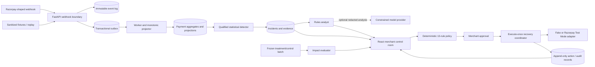

### System context

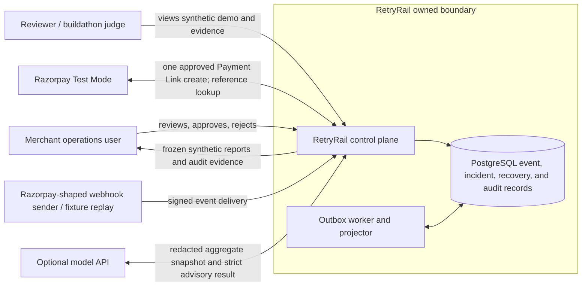

The diagram is a context view: the webhook sender and model API are external
inputs, but neither is trusted to make product decisions. The merchant is the
only approval authority, and Razorpay is only accessed through the configured
Test Mode adapter.

### Main architectural planes

| Plane | Responsibility | Durable evidence |
| --- | --- | --- |
| Ingestion | Raw-body signature validation, bounded parsing, deduplication | Immutable event and transactional outbox |
| Projection | Leased asynchronous processing, retries, dead letters, out-of-order safety | Monotonic payment projection and attempt record |
| Detection | Cohort windows, baseline comparison, statistical/business gates | Incident, observations, detector identity and evaluation receipt |
| Analysis | Evidence-cited rules explanation and optional model advice | Snapshot-, schema-, prompt-, and model-bound provenance |
| Control | Server-owned plan context, policy, merchant decision | Immutable plan, policy decisions, approval/consumption records |
| Execution | Atomic consumption and durable pre-network dispatch | Action, transition, provider receipt and reconciliation receipt |
| Measurement | Frozen assignment, outcome attribution, uncertainty | Protocol, assignment freeze, outcome batch and report |
| Operations | Trace correlation, redaction, metrics, readiness | Trace lineage, operational metrics and release dashboards |

The trust model and decision records are documented in
[`docs/ARCHITECTURE.md`](ARCHITECTURE.md) and the numbered records in
[`docs/adr/`](adr/).

### Detailed runtime topology

```mermaid
flowchart LR
    subgraph Inputs["Inputs"]
        RP["Razorpay-shaped webhook"]
        FX["Sanitized fixtures and replay"]
    end
    subgraph Ingest["Authenticated ingestion"]
        RAW["Bounded raw request bytes"]
        SIG{"HMAC valid?"}
        PARSE["Parse and validate strict event"]
        DEDUP{"Merchant + event ID exists?"}
    end
    subgraph Store["PostgreSQL durable boundary"]
        EVENT[("Immutable event")]
        OUTBOX[("Transactional outbox")]
        PROJ[("Monotonic payment projection")]
        INCIDENT[("Incident and detector evidence")]
        AUDIT[("Append-only plan, approval, action, receipt")]
    end
    subgraph Analysis["Detection and explanation"]
        AGG["Cohort aggregates"]
        DET["Qualified statistical detector"]
        RULES["Evidence-cited rules brief"]
        MODEL["Optional redacted model advice"]
    end
    subgraph Control["Merchant-controlled recovery"]
        WEB["React and Blade control room"]
        POLICY["13-rule deterministic policy"]
        APPROVE["Merchant review and one-time approval"]
        EXEC["Execute-once coordinator"]
        PROVIDER["Fake or Razorpay Test Mode"]
    end
    subgraph Measure["Batch measurement"]
        FREEZE["Frozen assignment and protocol"]
        OUTCOME["Same-payment outcomes"]
        REPORT["Incremental GMV report and interval"]
    end

    RP --> RAW
    FX --> RAW
    RAW --> SIG
    SIG -- No --> REJECT["Reject before persistence"]
    SIG -- Yes --> PARSE --> DEDUP
    DEDUP -- Duplicate --> ACK["Idempotent acknowledgement"]
    DEDUP -- New --> EVENT
    EVENT --> OUTBOX
    OUTBOX --> PROJ
    PROJ --> AGG --> DET
    DET --> INCIDENT
    INCIDENT --> RULES
    RULES -. "optional, advisory only" .-> MODEL
    INCIDENT --> WEB
    RULES --> WEB
    MODEL --> WEB
    WEB --> POLICY --> APPROVE --> EXEC --> PROVIDER
    EXEC --> AUDIT
    PROVIDER --> AUDIT
    AUDIT --> WEB
    FREEZE --> OUTCOME --> REPORT --> WEB
```

The storage box is the durability boundary. The model branch has no edge into
the detector, policy, approval, or provider authority; it can only contribute a
validated advisory result to the merchant view.

## 7. Technology stack

### Backend and analytics

- Python `>=3.12,<3.14`; lockfile pins the reproducible environment.
- FastAPI and Uvicorn for typed HTTP services.
- Pydantic/Pydantic Settings for strict contracts and validated configuration.
- SQLAlchemy 2 and Psycopg for database access.
- Alembic for versioned database migrations.
- Structlog for structured application logging.
- Prometheus client for bounded operational/business metrics.
- `httpx` for bounded external provider/model HTTP access.
- Ruff, strict mypy, pytest, pytest-cov, Hypothesis, Bandit, and pip-audit.

### Frontend

- React 18 and TypeScript 5 in strict mode.
- Vite for development and production bundling.
- Razorpay Blade components and design tokens for merchant-facing UI.
- TanStack Query, React Router, Zod, and controlled client-side API state.
- Vitest and Testing Library for unit/component tests; Playwright for Chromium
  stories.
- A narrow secure deep-merge compatibility helper is tested separately.

### Storage, runtime, and delivery

- PostgreSQL 16 is the deployment and CI database; SQLite supports focused local
  and test workflows.
- Docker Compose provides API, worker, database, migration, web and optional
  observability services.
- GitHub Actions runs Python/PostgreSQL, web/build/browser, security/dependency,
  and container verification jobs.
- Render Blueprint and a digest-pinned Dockerfile define the reviewer sandbox.
- Prometheus and Grafana are optional local services with pinned images and a
  provisioned dashboard.

## 8. Repository structure

```text
apps/
  web/                         React + TypeScript control room and browser tests
contracts/
  domain/                      Recovery, incident, experiment and evidence schemas
  events/                      Webhook delivery and payment event schemas
  tools/                       Typed model analyst input/output schemas
docs/
  adr/                         Append-only architecture decision records
  assets/                      System map and review/demo images
  *.md                         Requirements, architecture, operations, evidence
evals/
  blind/                       Append-only detector blind-run receipts and outputs
  experiments/                 Recovery protocol, assignment freeze and outcomes
  golden/                      Frozen candidate and analyst evaluation cases
  protocols/                   Versioned detector evaluation protocols
  reports/                     Reproducible summaries and sanitized Test Mode proof
fixtures/
  manifests/                   Deterministic synthetic data identities
  webhooks/                    Sanitized Razorpay-shaped event examples
infra/
  grafana/                     Provisioned dashboard and data source
  prometheus/                  Metrics scrape configuration
  render/                      Reviewer deployment Dockerfile
  git-hooks/                   Optional pre-push secret scan hook
services/api/
  app/retryrail/                FastAPI service, domain modules, worker
  migrations/                   Alembic migration history
  tests/                        Backend unit, integration, contract and security tests
  Dockerfile                    API/runtime container
```

Other root files include `AGENTS.md` (repository work contract), `README.md`,
`Makefile`, `pyproject.toml`, `uv.lock`, `package.json`, `pnpm-lock.yaml`,
`docker-compose.yml`, `.env.example`, `render.yaml`, `LICENSE`, and CI
configuration. Detailed source inventories appear in the repository map in
[`README.md`](../README.md) and in this overview's evidence index.

## 9. Backend implementation

### FastAPI composition root

`services/api/app/retryrail/main.py` constructs the app, validated settings,
database, pipeline metrics, ingestion and detection services, recovery workflow,
provider adapter, analyst/fallback, audit verifier, frozen experiment report
service, security headers, CORS policy, and routers. In review mode interactive
OpenAPI pages are disabled. When configured, the same process serves the
compiled web application.

### Module map

| Package | Main responsibility |
| --- | --- |
| `api/` | Health, webhook, incident, replay, recovery, and experiment HTTP routes |
| `contracts/` | Pydantic domain contracts and generated JSON Schema export/check |
| `db/` | Database/session lifecycle, tables, Alembic migration command |
| `detection/` | Baseline, detector engines, protocol, freeze, blind runs, scoring |
| `events/` | Immutable event ingestion, outbox claiming, event projection |
| `experiments/` | Recovery report contract and authenticated report service |
| `observability/` | Structured redaction, Prometheus metrics, W3C trace support |
| `policy/` | Pure deterministic policy evaluator |
| `recovery/` | Briefs, model analyst, workflow, adapter, execution, audit, evaluation |
| `security/` | Repository secret/history scan, pre-push, dependency audit |
| `synthetic/` | Deterministic generator and versioned ground-truth data |
| `webhooks/` | Signature, payload, and allowlisted normalization helpers |

`worker.py` runs bounded outbox work and exposes a separate worker metrics
endpoint. `detect.py` exposes the one-shot detection command. `replay.py`
supports deterministic replay and protected workflows. Console scripts are
registered in `pyproject.toml`.

## 10. Webhook, event, and projection pipeline

### Request handling

The webhook route reads a bounded request body as bytes, enforces the configured
maximum size, validates the Razorpay HMAC-SHA256 signature against those exact
unmodified bytes, and only then parses and validates the event. This avoids
signature mismatches or parser transformations changing what was authenticated.

### Identity and durable write

Deduplication uses the configured merchant scope together with the
`x-razorpay-event-id` header. A database transaction stores the immutable
normalized event and an outbox item together. A repeated delivery returns an
idempotent result without producing a second logical event or processing chain.

### Outbox and worker

The worker claims batches under a lease, using database coordination that
allows multiple workers to avoid claiming the same live item. It retries with
bounded attempts/backoff, recovers expired leases, and records poison items as
observable dead letters. Event acknowledgement is decoupled from projection,
so an acknowledged event remains recoverable after worker failure.

### Projection correctness

Payment state is monotonic. For example, a late `authorized` event cannot
regress a payment already projected as `captured`. The normalized contract
accepts an allowlist of useful payment and error fields and excludes raw card,
VPA, contact, note, token, and credential values. Trace identifiers are
correlation metadata only and never grant authority.

See [`docs/EVENT_PIPELINE.md`](EVENT_PIPELINE.md),
`services/api/app/retryrail/api/webhooks.py`, `events/ingestion.py`,
`events/outbox.py`, and `events/projector.py`.

### Event delivery and failure paths

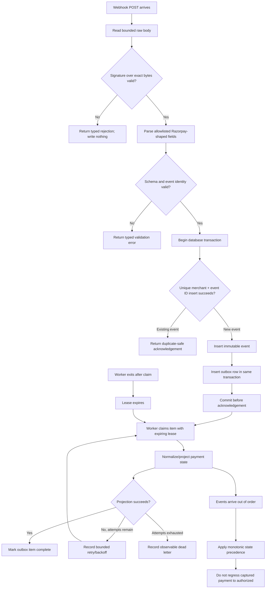

The event and outbox insert are atomic: acknowledgement follows commit. A
worker lease makes interrupted work reclaimable, while the projection's
monotonic rule handles valid but delayed events independently of delivery
order.

## 11. Synthetic data and ground truth

The committed data is generated deterministically from versioned seeds and
manifests. The generator creates payment attempts, Razorpay-like events,
delivery schedules, and scenario labels. It includes ordinary traffic,
degradation scenarios, a deceptive/hard-negative cohort, and delivery
reliability cases such as duplicates, delays, and out-of-order events.

The default committed truth-set has more than 2,000 synthetic attempts; the
official v4 blind detector evaluation contains **5,760 attempts and 10,676
normalized events**. The M5 recovery experiment selects **280 eligible failed
payments** from the batch. These are distinct evaluation populations with
different purposes.

Data partitions and identities are content-addressed. Development inputs may
be used during candidate construction; held-out/official blind truth is only
revealed after a prediction artifact has been persisted and committed. The
blind runner records nonce commitment/reveal, source and config digests,
prediction receipt, truth access receipt, report and release decision. The
append-only procedure preserves failures and prevents a failed blind run from
being rewritten into a pass.

No synthetic user/customer is represented as a real person. All simulated
outcomes carry explicit synthetic labels in UI, contracts, and reports.

## 12. Detector and diagnosis

### What detection means

The detector identifies a **merchant-local cohort degradation**. It evaluates
time windows and cohort dimensions rather than allowing an LLM to infer an
incident from unvalidated prose. Its output records observed performance,
baseline, counts, statistical evidence, impact and attribution evidence.

### Detection ingredients

The qualified v4 detector uses a leakage-safe baseline, minimum sample and
business-impact gates, proportion/confidence analysis, EWMA/CUSUM behavior,
temporal incident rules, and hierarchy/arbitration logic to avoid overlapping
incidents for the same underlying cohort. Root-cause ranking uses payment
dimensions and available Razorpay error evidence such as method, issuer,
source, step, and reason. Reports distinguish facts from hypotheses and
unknowns; a merchant-local correlation is not described as proof that a bank
or network is globally down.

### Honest candidate history

| Version | Official synthetic result | Release status |
| --- | --- | --- |
| v1 | 0 precision / 0 recall | Failed; retained as historical evidence |
| v2 | 6 TP / 0 FP / 0 FN; 900-second median delay; baseline leakage violations | Blocked |
| v3 | 5 TP / 1 FP / 1 FN; required-nullable report-contract defect | Blocked and procedurally invalid |
| v4 | 6 TP / 0 FP / 0 FN; all frozen targets and adversarial gates pass | Qualified for exact synthetic runtime activation |

The actual runtime recovery gate binds the exact v4 candidate, official blind
report, release decision, and configuration digests. Frozen historical
artifacts are not edited to add later runtime eligibility. The separate
activation fact is checked by the recovery workflow.

### Detector decision path

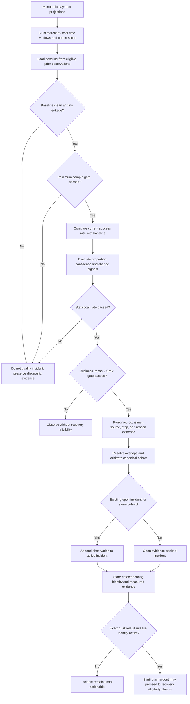

### Diagnosis evidence path

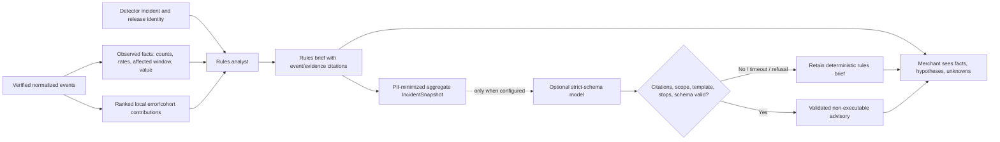

The diagnosis path does not feed back into detector qualification. A failed
model call leaves the persisted rules brief usable and does not interrupt the
merchant workflow.

### Incident lifecycle

The domain contract deliberately has two persisted incident states. Healthy
windows and further degraded observations are detector observations that
advance the lifecycle; they are not extra persisted statuses.

```mermaid
stateDiagram-v2
    [*] --> Open: qualified degradation opens incident
    Open --> Open: further degraded observations / evidence appended
    Open --> Open: insufficient healthy evidence; keep monitoring
    Open --> Resolved: configured healthy window is satisfied
    Resolved --> [*]: resolution time and final evidence persisted
```

### Detector result

The qualifying official v4 blind report records 6 true positives, no false
positives, no false negatives, **100% precision, 100% recall, 100% top-1
attribution**, and a **600-second median simulated first-signal delay**. This
is evidence on a particular synthetic benchmark, not a production performance
guarantee.

Read [`docs/DETECTOR.md`](DETECTOR.md),
[`docs/DETECTOR_V4_PROTOCOL.md`](DETECTOR_V4_PROTOCOL.md),
[`docs/DETECTOR_V4_CANDIDATE.md`](DETECTOR_V4_CANDIDATE.md), and
[`docs/DETECTOR_V3_PROTOCOL.md`](DETECTOR_V3_PROTOCOL.md) for methodology and
preserved prior outcomes.

## 13. AI incident analyst

The model is an optional explanation component behind an already-valid
deterministic path.

### Rules-first behavior

The service persists a content-addressed rules brief based on verified incident
evidence before contacting an optional model. The fallback can diagnose and
create the same safe recovery plan if the model is disabled, slow, malformed,
refuses, or is unavailable. The demo can therefore complete without LLM access.

### Model input and output

The model receives an aggregate-only `IncidentSnapshot`. It excludes merchant,
payment, customer and contact identities; raw events; free-text notes and
descriptions; credentials; tokens; and execution authority. Provider storage is
disabled, time and output are bounded, and at most one clean schema
regeneration is permitted.

The analyst must emit strict typed `IncidentBrief` and `RecoveryProposal`
structures. Material claims cite known evidence. Deterministic grounding checks
citations, amount/currency, merchant-local scope, approved template, stop
conditions and non-executable status. The model has no tools or payment
credentials and cannot issue approval tokens or call the provider.

Any refusal, timeout, provider error, invalid schema, unsupported claim, scope
drift, or failed grounding returns the existing rules result. Provider text
and secrets are not retained in evaluation reports.

### Evaluation

The M6 fixed corpus contains **24 cases across three dated model candidates**
(72 evaluations), covering evidence grounding, abstention, privacy, prompt
injection, scope, action trajectory, and schema behavior. The selected model
recorded 95.83% grounding and passed every frozen selection gate; all candidates
recorded zero unsafe model actions in this fixed evaluation. The report selects
`gpt-5.4-nano-2026-03-17`. This is synthetic evaluation evidence, not a blanket
claim about model safety or live data governance.

See [`docs/INCIDENT_ANALYST.md`](INCIDENT_ANALYST.md),
`contracts/tools/`, `services/api/app/retryrail/recovery/incident_analyst.py`,
`openai_analyst.py`, and `analyst_evaluation.py`.

## 14. Policy, approval, and recovery execution

### Deterministic policy

The pure, versioned policy engine evaluates all **13 deterministic rules** and
returns the complete allow/deny reason set without short-circuiting. The rules
cover:

1. Merchant scope.
2. Qualified detector/action eligibility.
3. Operating mode and review-first requirement.
4. Recovery template enablement.
5. Verified original amount.
6. Currency.
7. Customer-contact consent where applicable.
8. Opt-out state.
9. Attempt cap.
10. Cooldown.
11. Plan/approval expiry.
12. Recovery kill switch.
13. Already-recovered or otherwise stopped payment.

The policy engine itself does no I/O and grants no execution authority. Server
code reconstructs money, merchant, consent, eligibility, mode, and controls
from locked database records and validated settings. Caller-provided identity
and idempotency values cannot override those facts.

### Preview and approval

The merchant first sees the exact action amount, currency, expiry, reference,
notification behavior, eligibility, policy outcomes, and stop conditions. A
permitted preview yields a short-lived 256-bit approval bearer. It is returned
once and only an HMAC-SHA-256 digest is stored. It expires no later than both
the configured cap and the plan expiry. Approval is outside the model and bound
to the specific plan and preview evidence.

### Execute-once transaction

Immediately before execution, the server locks authoritative records and
reevaluates mutable policy facts. On denial it records the reason and makes no
provider call. On allow, token consumption, action creation, initial state
transitions, attempt-control advancement, and immutable provider dispatch are
committed before network I/O. Replays with the same idempotency key return the
same durable action; key rebinding is rejected.

The state sequence is:

```text
previewed → awaiting_approval → approved → executing
                                           ├→ succeeded
                                           ├→ failed
                                           └→ reconciliation_required
                                                ├→ succeeded
                                                └→ failed
```

### Approval and provider interaction sequence

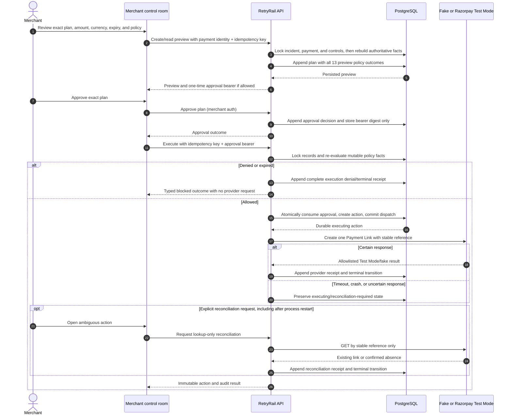

The execution ordering is intentional: the policy/approval/action/dispatch
transaction commits **before** the provider request. If the process dies after
the remote create, replay cannot create another link; it can only reconcile by
the already-persisted reference.

### Policy decision map

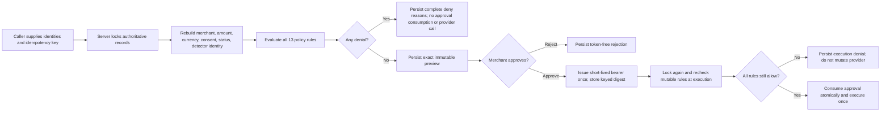

An ambiguous timeout never takes a second create path. The next operation is a
lookup by the persisted stable reference. A complete audit verifier requires a
consistent source event, incident, brief, plan, preview and execution policy,
merchant decision, token consumption, action, dispatch, provider receipt,
terminal transition, and reconciliation evidence if applicable.

The canonical policy and workflow explanations are
[`docs/POLICY.md`](POLICY.md) and
[`docs/RECOVERY_WORKFLOW.md`](RECOVERY_WORKFLOW.md).

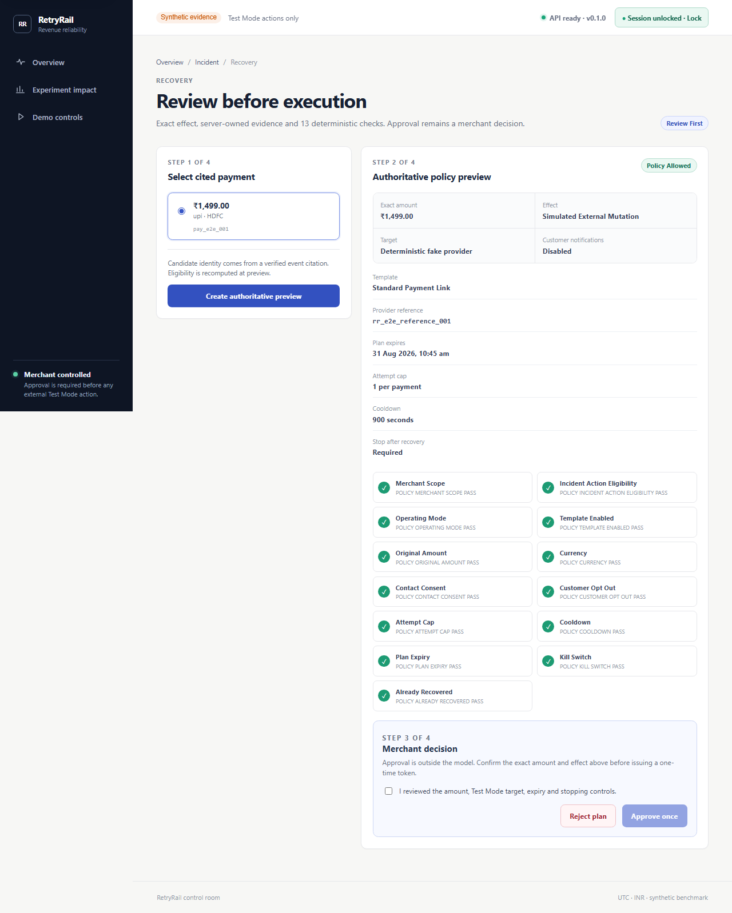

## 15. Razorpay Test Mode adapter

The recovery adapter is an interface with two bounded implementations:

- **Deterministic fake** — default local/reviewer execution target. It accepts
  synthetic plans, is explicitly labeled simulated, and makes no external call.
- **Razorpay Test Mode** — optional, credentials must use the Test Mode key
  prefix, and the adapter creates a Standard Payment Link. It stores only a
  sanitized allowlisted receipt, not credentials or a raw provider response.

The request contains the verified amount in integer currency subunits,
currency, expiry, and stable `reference_id`; external notifications are
disabled. It does not include a customer contact object. Redirects, malformed
responses, timeouts, oversized responses, provider status failures, and bounded
clock skew are handled through typed outcomes. Test keys remain process-only
secrets and never enter the browser.

The committed external proof records **one human-approved INR 1,499.00 Test
Mode Payment Link, one POST accepted with HTTP 200, and a subsequent GET by
stable reference** after a crash-equivalent local parse/receipt interruption.
RetryRail did not repeat the POST. The receipt records synthetic/no-real-money
scope, notifications off, complete audit, and absence of persisted credentials
and raw response data. It is an integration proof, not a real-money or
production-volume result.

See [`docs/RAZORPAY_TEST_MODE.md`](RAZORPAY_TEST_MODE.md),
`services/api/app/retryrail/recovery/adapter.py`,
`recovery/execution.py`, and
[`evals/reports/razorpay_test_mode_receipt.v1.json`](../evals/reports/razorpay_test_mode_receipt.v1.json).

## 16. Recovery experiment and impact measurement

RetryRail distinguishes gross recovery from incremental impact. A holdout
estimates how many payments recover naturally without the intervention.

### Frozen protocol

- Source scan: 5,760 synthetic payment attempts.
- Eligible batch: 280 failed incident-member payments, all retained in the
  analysis.
- Assignment unit: payment ID.
- Treatment/control: 224 / 56 (80% / 20%).
- Stratification: 20 method × issuer × amount-band strata.
- Assignment: outcome-independent SHA-256 ranking with Hamilton apportionment.
- Attribution: the same failed payment must recover within 86,400 seconds
  (24 hours).
- Primary estimate: treatment/control recovered value per eligible payment,
  scaled to the treatment population.
- Uncertainty: deterministic 10,000-replicate independent-arm percentile
  bootstrap with a 95% interval.
- Conclusion rule: inconclusive if the primary interval includes zero.

The frozen protocol and assignment precede outcomes. Results are immutable,
versioned, and labeled `synthetic_batch_not_live_merchant_performance`.

```mermaid
flowchart LR
    A["All 5,760 synthetic attempts"] --> B["Apply frozen eligibility rules"]
    B --> C["280 eligible failed incident-member payments"]
    C --> D["Stratify by method × issuer × amount band"]
    D --> E["Hash-ranked assignment fixed before outcomes"]
    E --> F["Treatment: 224 payments"]
    E --> G["Control: 56 payments"]
    F --> H["Observe same-payment recovery within 24 hours"]
    G --> I["Observe same-payment natural recovery within 24 hours"]
    H --> J["Calculate rates and recovered value"]
    I --> J
    J --> K["Subtract control-estimated natural recovery"]
    K --> L["10,000-replicate deterministic bootstrap"]
    L --> M{"95% interval excludes zero?"}
    M -- Yes --> N["Report positive synthetic estimate with uncertainty"]
    M -- No --> O["Report inconclusive result"]
    N --> P["Subtract modeled intervention costs for net value"]
    O --> P
```

### Committed batch result

| Metric | Result | Meaning |
| --- | ---: | --- |
| Eligible payments | 280 | Complete eligible synthetic batch |
| Treatment / control | 224 / 56 | Frozen before outcomes |
| Recovered payments | 116 / 7 | Same-payment attribution within 24 hours |
| Absolute recovery-rate uplift | 39.29 percentage points | Treatment rate minus control rate |
| Gross treatment recovered GMV | ₹200,884 | Descriptive gross value in treatment |
| Estimated natural recovery | ₹79,972 | Control-based counterfactual for treatment scale |
| Incremental recovered GMV | ₹120,912 | Gross minus estimated natural recovery |
| Modeled costs | ₹772 | Action and false-intervention costs |
| Net recovered value | ₹120,140 | Incremental value minus modeled costs |
| 95% bootstrap interval | ₹44,447–₹189,391 | Interval for incremental recovered GMV |

This committed report's interval excludes zero under the frozen evaluation
protocol. These are simulated outcomes and must never be presented as actual
merchant results, Razorpay revenue, or live campaign performance.

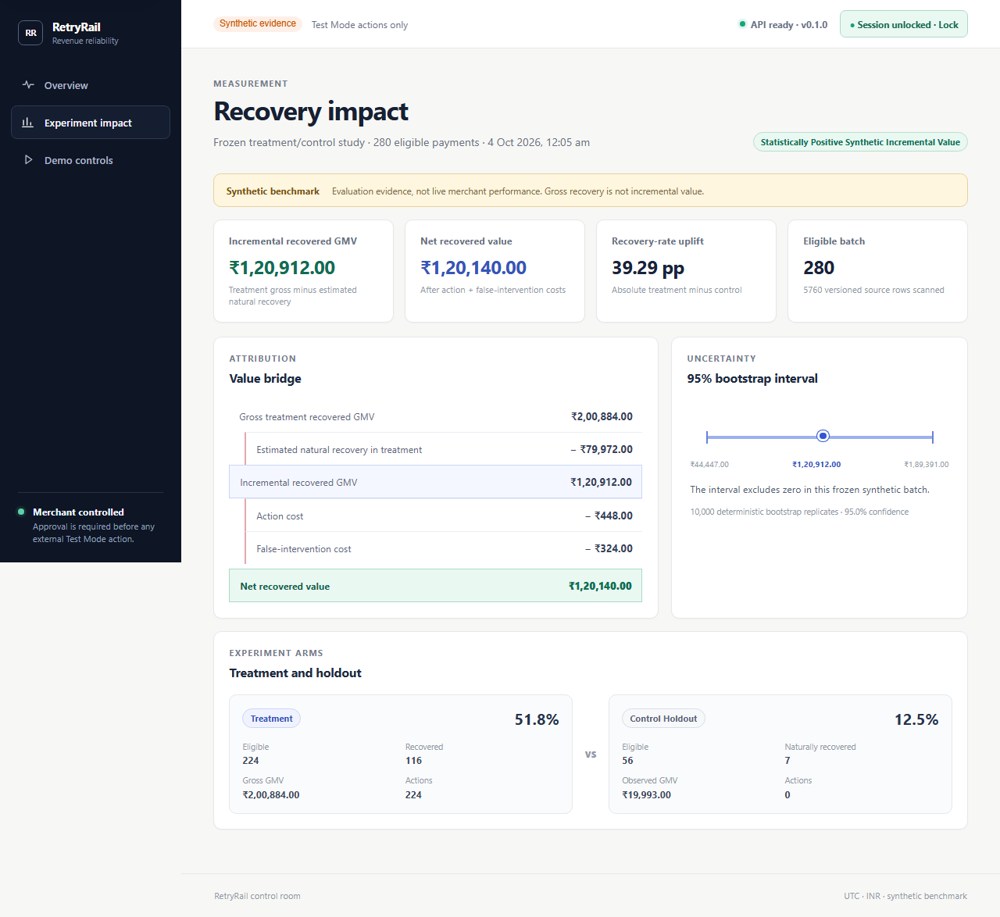

See [`docs/M5_EXPERIMENT_PROTOCOL.md`](M5_EXPERIMENT_PROTOCOL.md),
`evals/experiments/recovery_v1/`,
[`evals/reports/recovery_experiment_v1.report.json`](../evals/reports/recovery_experiment_v1.report.json),
and `services/api/app/retryrail/experiments/`.

## 17. Merchant web application

The responsive control room is built from React, TypeScript, and Razorpay
Blade. It exposes the lifecycle as evidence and state, not as an unrestricted
chat transcript.

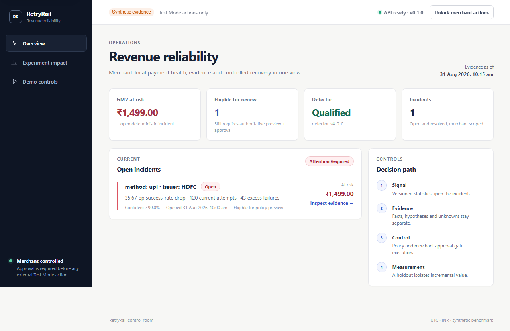

### Main views

| View | Purpose |
| --- | --- |
| Overview | Payment health, open incidents, at-risk value, detector identity, recent activity, and system/demo status |
| Incident | Cohort facts, baseline/current observations, error attribution, citations, hypotheses, unknowns and incident lifecycle |
| Recovery | Candidate selection, grounded fallback/model brief, plan preview, all policy results, merchant approval or rejection, and action result |
| Impact | Frozen experiment population, treatment/holdout recovery, gross versus incremental value, costs, net value and uncertainty |
| Demo | Bounded synthetic replay/detection narrative and safe offline/empty/failure states |

### Frontend behavior and safeguards

- API responses are runtime-validated before rendering.
- The browser has no Razorpay or OpenAI client.
- Merchant authorization and one-time approval bearers remain in browser memory;
  they are not written to persistent browser storage.
- The plan is previewed before decision; the UI exposes all policy outcomes.
- The user can approve or reject using keyboard interaction.
- A denied policy state cannot advance to execution.
- An ambiguous action presents lookup-only reconciliation.
- A locked merchant session clears in-memory authorization and approval values.
- Offline, loading, empty, unavailable, denied, success, and recovery states are
  modeled in the interface.
- Synthetic and Test Mode boundaries remain visible in the product.

### Merchant journey map

```mermaid
flowchart LR
    LOCK["Session locked"] --> UNLOCK["Unlock local merchant session"]
    UNLOCK --> OVERVIEW["Overview: health, open incidents, at-risk value"]
    OVERVIEW --> INCIDENT["Incident: cohort, baseline, evidence, uncertainty"]
    INCIDENT --> ANALYSIS["Run analysis"]
    ANALYSIS --> RULES["Persisted rules brief"]
    ANALYSIS -. "optional provider unavailable" .-> RULES
    RULES --> CANDIDATE["Choose eligible synthetic payment"]
    CANDIDATE --> PREVIEW["Preview exact action and stop conditions"]
    PREVIEW --> POLICY{"All 13 policy checks pass?"}
    POLICY -- No --> BLOCKED["Show deny reasons; no approval or execute control"]
    POLICY -- Yes --> DECIDE{"Merchant decision"}
    DECIDE -- Reject --> REJECTED["Persist rejection; no provider call"]
    DECIDE -- Approve --> EXECUTE["Execute one approved action"]
    EXECUTE --> RESULT{"Provider outcome"}
    RESULT -- Certain --> AUDIT["Action timeline and audit proof"]
    RESULT -- Ambiguous --> LOOKUP["Lookup-only reconciliation"] --> AUDIT
    OVERVIEW --> IMPACT["Impact: treatment/control and incremental GMV"]
    AUDIT --> IMPACT
    IMPACT --> DEMO["Bounded synthetic demo"]
```

Navigation and session state are presentation concerns. The API still
reconstructs policy context and enforces approval, so navigating directly to a
screen cannot create execution authority.

Main files: `apps/web/src/App.tsx`, `AppRoot.tsx`, `components/Shell.tsx`,
`components/UI.tsx`, `pages/OverviewPage.tsx`, `IncidentPage.tsx`,
`RecoveryPage.tsx`, `ImpactPage.tsx`, `DemoPage.tsx`, `api/retryrail.ts`,
`session/`, and `styles.css`.

## 18. HTTP API reference

Routes use the `/api/v1` namespace except health and metrics. Mutating/merchant
routes use the configured `X-RetryRail-Merchant-Authorization` shared secret;
the approve/execute flow also uses a short-lived approval bearer. The exact
typed request and response contracts in the route modules are authoritative.

### Health and metrics

| Method and path | Purpose |
| --- | --- |
| `GET /health/live` | Process liveness |
| `GET /health/ready` | Configuration, database connectivity, and exact migration-head readiness |
| `GET /metrics` | Bounded-cardinality API Prometheus metrics |
| Worker `GET /metrics` on its configured port | Outbox worker operational metrics |

### Ingestion, reads, and demo

| Method and path | Purpose |
| --- | --- |
| `POST /api/v1/webhooks/razorpay` | Authenticate, deduplicate, and persist a Razorpay-shaped webhook |
| `GET /api/v1/overview` | Merchant control-room summary |
| `GET /api/v1/incidents` | Paginated/filterable incident list |
| `GET /api/v1/incidents/{incident_id}` | Incident evidence and lifecycle detail |
| `GET /api/v1/incidents/{incident_id}/recovery-candidates` | Eligible, cited synthetic recovery candidates |
| `POST /v1/demo/replay` | Protected deterministic fixture replay when enabled |
| `POST /v1/demo/run` | Protected bounded detection demo; waits for projections to settle |

### Recovery and impact

| Method and path | Effect |
| --- | --- |
| `POST /api/v1/incidents/{incident_id}/analyze` | Append grounded advisory analysis; safe fallback on model failure |
| `POST /api/v1/incidents/{incident_id}/plans` | Create authoritative preview and complete preview policy result |
| `POST /api/v1/plans/{plan_id}/preview` | Read and verify stored plan preview |
| `POST /api/v1/plans/{plan_id}/approve` | Record merchant decision and return one short-lived bearer once |
| `POST /api/v1/plans/{plan_id}/reject` | Record token-free rejection |
| `POST /api/v1/plans/{plan_id}/execute` | Recheck policy, consume approval atomically, persist dispatch, execute once |
| `POST /api/v1/actions/{action_id}/reconcile` | Lookup ambiguous provider result by stable reference; no create |
| `GET /api/v1/actions/{action_id}` | Read action timeline and audit-completeness proof |
| `GET /api/v1/experiments/{experiment_id}` | Read the authenticated frozen synthetic experiment report |

The API's clients provide identities and idempotency keys. They do not submit
authoritative money, consent, provider mode, eligibility, policy or notification
facts. Strict Pydantic request models reject extra fields. Replay and demo
routes are disabled by default and require a separate replay token when
enabled. Interactive OpenAPI is available only in development/test settings.

For exact status codes, error models, and side effects, inspect
`services/api/app/retryrail/api/` and `docs/CONTRACTS.md`.

## 19. Contracts and database

### Contract families

- **Events:** webhook delivery, Razorpay-shaped webhook, normalized payment
  event.
- **Domain:** synthetic dataset manifest, ground truth, detector evaluation,
  incident, policy result, recovery template/plan/action, approval, action
  receipt, experiment design/protocol/assignment/outcome/report, and Test Mode
  evidence.
- **Analyst tools:** aggregate incident snapshot, brief, recovery proposal, and
  model analysis provenance.

Pydantic models are the typed source for generated JSON Schemas. The contract
checker detects drift and verifies fixture/data identities. Existing frozen
contracts are protected against unreviewed byte changes.

### Database design

PostgreSQL stores durable event/projection state plus append-only decision and
action evidence. SQLAlchemy tables are in
`services/api/app/retryrail/db/tables.py`; migration environment and revisions
are under `services/api/migrations/`.

Documented migration lineage:

| Revision | Subject |
| --- | --- |
| `0001_m2_event_pipeline` | Immutable event ingestion and outbox pipeline |
| `0002_m3_detection_incidents` | Detection observations and incident lifecycle |
| `0003_m4_preview_approval` | Recovery controls, plans, preview policy and approvals |
| `0004_m4_action_execution` | Execution policy, actions, transitions, reconciliation |
| `0005_m4_rules_fallback` | Content-addressed deterministic rules briefs |
| `0006_m5_provider_dispatch` | Durable dispatch and sanitized provider receipts |
| `0007_m6_model_incident_analysis` | Validated advisory output and provenance |
| `0008_m8_trace_lineage` | Immutable trace lineage and correlation backfill |

PostgreSQL triggers protect append-only audit evidence from update/delete.
Composite keys enforce merchant/incident/plan relationships; unique
constraints support deduplication, idempotency and stable provider reference
identity. UTC-aware timestamps and integer currency subunits with explicit
currency are used at boundaries.

### Evidence lineage (conceptual)

This diagram shows the logical audit chain. It is a reading aid; exact table
names, keys, and cardinalities are defined in SQLAlchemy models and migrations.

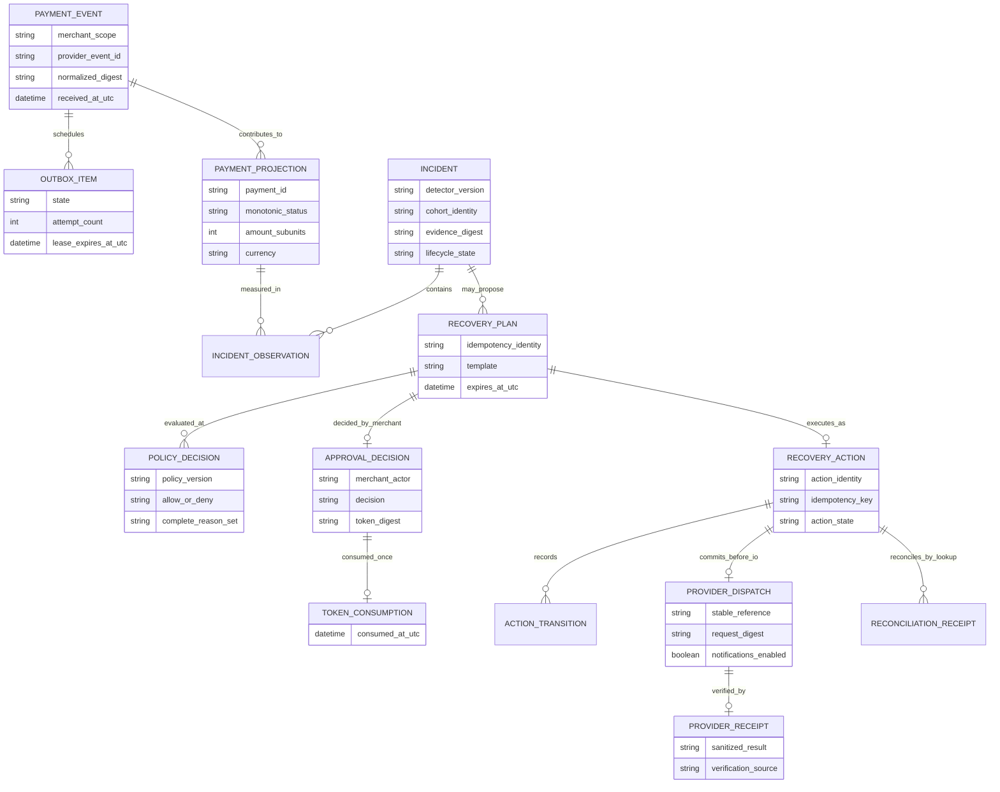

## 20. Security, privacy, and authority boundaries

### Authority separation

| Actor/component | Authority | Explicitly cannot |
| --- | --- | --- |
| Detector | Open/resolve an incident from merchant-local statistics | Read model output or accept a model override |
| Rules/model analyst | Explain cited evidence and suggest a known template | Approve, set policy facts, execute, or call Razorpay |
| Grounding validator | Reject unsupported or out-of-scope claims | Turn a rejected answer into executable authority |
| Policy engine | Evaluate complete allow/deny rules against authoritative facts | Perform I/O or trust client-supplied amount/consent |
| Merchant route | Approve/reject the exact preview | Rebind the approval bearer to another plan/action |
| Executor | Recheck policy, consume approval, execute once | Blindly retry an uncertain provider create |
| Provider adapter | Create a Test Mode Payment Link or GET by stable reference | Accept live keys, message customers, or persist raw response |
| Observability | Correlate requests and emit bounded operational measures | Grant authentication, approval, detector, or provider authority |

### Security controls

- Signature validation uses the unmodified bounded raw body.
- Merchant plus Razorpay event ID scopes deduplication.
- Shared authorization comparison is constant-time; the current deployment
  remains a single configured merchant boundary.
- One-time approval bearer is random, short lived, bound to a plan and stored as
  an HMAC digest only.
- Recovery facts are reconstructed from locked server-owned records.
- Policy is re-evaluated immediately before provider dispatch.
- Dispatch commits before network I/O; ambiguous results are lookup-only.
- Provider credentials are Test Mode only, process-only, masked in settings,
  and excluded from browser bundles, logs, prompts, and receipts.
- Logs are structured, recursively redacted, and fail closed for credentials,
  tokens, authorization values, contacts and credential-like URLs.
- Metrics use fixed low-cardinality labels; merchant/payment/incident/action IDs
  are not metric labels.
- Security headers include CSP and other deployment hardening; production
  container processes run non-root.
- Security verification includes Bandit, secret/history scanning, pre-push
  scanning, Python and web dependency audits, and immutable container policy.

### Trust boundary and data flow

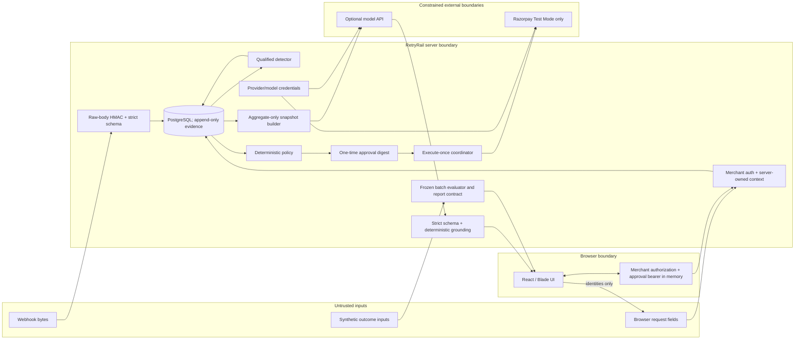

The merchant bearer is sent to authorized API routes but held in browser
memory; the model input snapshot contains neither that bearer nor provider
credentials. The optional model API key remains server-side and is used only
to authenticate the provider request. Razorpay credentials are server-side
and only configure the Test Mode adapter. Model output must pass grounding
before it is displayed as accepted advice and has no edge into policy or
execution.

See [`docs/SECURITY.md`](SECURITY.md),
[`docs/M8_RELEASE_HARDENING.md`](M8_RELEASE_HARDENING.md),
and [`docs/RAZORPAY_TEST_MODE.md`](RAZORPAY_TEST_MODE.md).

## 21. Observability and operations

### Correlation

The API accepts/continues valid W3C `traceparent` context and exposes
correlation identifiers in response headers. Immutable identifier-only lineage
connects event, outbox, incident, plan, and action. Trace identifiers are not
authorization credentials and are not treated as trusted decision inputs.

### Metrics

Prometheus metrics cover bounded pipeline activity, worker health, detector and
incident activity, analysis outcomes/latency/cost availability, recovery
results, experiment aggregate values, and readiness. Labels are bounded
enumerations rather than business identifiers. Optional local Prometheus and
Grafana use digest-pinned images and a provisioned dashboard.

### Health and shutdown

Readiness checks database connectivity and the exact expected Alembic revision.
The API and worker have bounded graceful shutdown behavior. Deployment
verification includes migration readiness and startup probes.

## 22. Evaluation results and evidence

The committed headline evidence, as documented by the project, is:

| Area | Evidence/result | Scope |
| --- | --- | --- |
| Qualified detector | 6 TP, 0 FP, 0 FN; 100% precision/recall/top-1 attribution; 600-second median delay | Official synthetic blind batch |
| Detector population | 5,760 attempts and 10,676 normalized events | Versioned synthetic v4 evaluation |
| Recovery impact | 280 eligible; 224/56 split; 116/7 recoveries; 39.29pp uplift | Synthetic, frozen treatment/control batch |
| Recovered value | ₹200,884 gross treatment; ₹120,912 incremental; ₹120,140 net | Synthetic outcome batch; not live GMV |
| Uncertainty | ₹44,447–₹189,391 95% bootstrap interval | Deterministic 10,000-replicate interval |
| Razorpay integration | INR 1,499 link; one POST; HTTP 200; one GET lookup recovery | Human-approved Razorpay Test Mode only |
| Analyst evaluation | 24 cases × 3 models = 72 evaluations; 95.83% grounding for selected model; zero unsafe actions in fixed corpus | Synthetic safety/quality corpus |
| PostgreSQL backend suite | 525 Python tests; 85.57% branch-aware coverage | Recorded exact release CI commit |
| Frontend | 13 tests; 90.05% statements | Recorded unit/component suite |
| Browser | Three Chromium workflow scenarios | Deterministic API interception; backend separately tested |
| CI | Five jobs passed for commit `5f8a06c903fec01ba9f67bd4586e242fc59d41b3` | Recorded GitHub Actions run `33982794739` |

The README links to canonical detector, impact, provider, model, and CI
artifacts. Historical counts in older milestone sections of
`docs/PROJECT_STATUS.md` are snapshots at different points and must not be
added together or presented as a single latest test run. A recorded successful
CI run proves the commit it tested, not an arbitrary later working tree.

## 23. Milestone history and current status

The build plan delivers the P0 core before optional scope:

| Milestone | Outcome |
| --- | --- |
| M0 | Repository, app/runtime skeleton, locked toolchains, health endpoints and CI |
| M1 | Versioned event/domain contracts, sanitized fixtures and deterministic truth data |
| M2 | Authenticated webhook, event log, outbox, worker, projection and replay |
| M3 | Initial detector, incident lifecycle and evaluation; v1 release failed honestly |
| M3R / v2 | Blind procedure complete; detector blocked by delay and baseline leakage |
| M3R.4 / v3 | Separate candidate and blind evidence preserved; blocked/procedurally invalid |
| R5.1–R5.5 / v4 | Precommitted remediation, development partitions, adversarial checks, freeze, official blind qualification and release hardening |
| M4 | Pure 13-rule policy, server-owned preview, merchant approval, execute-once fake path, reconciliation, rules fallback and audit verifier |
| M5 | Razorpay Test Mode provider proof and frozen treatment/control measurement |
| M6 | Bounded model analyst, grounding/fallback, provenance, 72-case bakeoff |
| M7 | Merchant control room, typed API, browser-memory session and end-to-end story |
| M8 | Trace lineage, recursive redaction, metrics/dashboard, clean-checkout and failure-matrix hardening |
| M9 | Deployment/submission package prepared and locally rehearsed; live publication and final submission operations remain pending |

The repository status document says the M9 deployment candidate uses one paid
Render web service, one worker, and PostgreSQL in Singapore, with a synthetic
healthy seed prefix and a protected incident-opening demo. Local exact-image
rehearsal and a five-job release CI run are recorded. Public repository
visibility, deployed public health checks, final screenshots, the final tag,
signed-out link checks, and the final five-minute video/submission are not
recorded as complete. The current state of external services should be checked
before relying on them.

## 24. Local setup and commands

### Prerequisites

- Git.
- Python 3.12 compatible with the project constraint.
- `uv` for Python lockfile install/run.
- Node.js 22 and `pnpm` 11.9.0 for web dependencies.
- Docker Desktop/Engine and Docker Compose for the full local stack.
- GNU Make for the documented `make` wrappers. On Windows PowerShell, the
  recorded status notes that GNU Make was not available on the verification
  host; individual commands can be invoked directly if the dependencies exist.

### Bootstrap

From the repository root:

```bash
make bootstrap
```

This runs a frozen `uv` sync, frozen `pnpm` install, and installs Chromium for
Playwright. If using a fresh clone, first inspect the current `AGENTS.md` and
`.env.example`. Copy `.env.example` to a local `.env` only when needed and
replace local-only placeholder secrets. Never commit `.env` or actual provider
credentials.

### Start local services

```bash
make dev
```

Compose starts PostgreSQL, the migration job, API, worker, and Vite frontend.
The frontend is normally at `http://localhost:5173`, the API at
`http://localhost:8000`, readiness at `http://localhost:8000/health/ready`,
and worker metrics at port `9101`. Optional Prometheus/Grafana are started with
`make observability-up` and use local ports 9090/3000. Ports and exact service
configuration are defined in `docker-compose.yml`.

### Handy development commands

```bash
make migrate                  # Apply current Alembic migrations
make seed                     # Regenerate deterministic default synthetic data
make replay                   # Run required reliability replay cases
make detect                   # Refresh aggregates/incidents once
make demo                     # Run bounded demo checks
make observability-check      # Check local observability configuration/tests
```

Replay/detection operations may require database services and validated local
configuration. The Razorpay Test Mode workflow is intentionally separate and
human-approved; follow `docs/RAZORPAY_TEST_MODE.md`, which explains preparation,
interactive approval, and lookup-only reconciliation. Do not put keys into
commands that will be saved in shell history when avoidable.

## 25. Configuration reference

The complete list and safe defaults live in `.env.example` and are validated
by `services/api/app/retryrail/config.py`. Common settings:

| Variable | Purpose |
| --- | --- |
| `RETRYRAIL_ENVIRONMENT` | Runtime mode (`development`, `test`, or review/deployment mode) |
| `RETRYRAIL_DATABASE_URL` | PostgreSQL/SQLite connection string |
| `RETRYRAIL_MERCHANT_ID` | Configured merchant scope for the P0 single-merchant boundary |
| `RETRYRAIL_WEBHOOK_SECRET` | HMAC secret for Razorpay-shaped webhooks |
| `RETRYRAIL_MERCHANT_APPROVAL_SECRET` | Merchant API authorization secret |
| `RETRYRAIL_APPROVAL_TOKEN_HMAC_KEY` | Separate key to digest one-time approval bearers |
| `RETRYRAIL_MERCHANT_APPROVER_ID` | Server-owned actor recorded for approval |
| `RETRYRAIL_RECOVERY_MODE` | Review-first or analysis-only operating mode |
| `RETRYRAIL_RECOVERY_TEMPLATE_ENABLED` | Enable/disable bounded Payment Link template |
| `RETRYRAIL_RECOVERY_KILL_SWITCH` | Block new recovery mutations when enabled |
| `RETRYRAIL_RECOVERY_PLAN_LIFETIME_SECONDS` | Preview/plan expiry window |
| `RETRYRAIL_APPROVAL_TOKEN_LIFETIME_SECONDS` | Approval bearer lifetime cap |
| `RETRYRAIL_RECOVERY_MAXIMUM_ATTEMPTS_PER_PAYMENT` | Action attempt limit |
| `RETRYRAIL_RECOVERY_COOLDOWN_SECONDS` | Minimum gap between attempts |
| `RETRYRAIL_RECOVERY_EXECUTION_TARGET` | `deterministic_fake` or protected Test Mode adapter |
| `RETRYRAIL_RAZORPAY_KEY_ID` / `_KEY_SECRET` | Optional Test Mode process-only credentials |
| `RETRYRAIL_RAZORPAY_CONNECT_TIMEOUT_SECONDS` / `_READ_TIMEOUT_SECONDS` | Bounded provider request timeouts |
| `RETRYRAIL_INCIDENT_ANALYST_TARGET` | Deterministic rules default or validated optional analyst |
| `RETRYRAIL_OPENAI_API_KEY` | Optional external model secret; never browser-exposed |
| `RETRYRAIL_OPENAI_INCIDENT_MODEL` | Model selection, constrained to frozen M6 winner when enabled |
| `RETRYRAIL_OPENAI_TIMEOUT_SECONDS` / `_MAX_OUTPUT_TOKENS` / `_MAX_SCHEMA_REPAIRS` | Model resource bounds |
| `RETRYRAIL_REPLAY_ENABLED` / `RETRYRAIL_REPLAY_TOKEN` | Explicitly enable and authorize local/reviewer replay/demo endpoints |
| `RETRYRAIL_MAX_WEBHOOK_BODY_BYTES` | Maximum raw webhook request size |
| `RETRYRAIL_OUTBOX_MAX_ATTEMPTS` | Bounded worker retry attempts |
| `RETRYRAIL_WORKER_BATCH_SIZE`, `_POLL_INTERVAL_SECONDS`, `_LEASE_SECONDS`, `_RETRY_BASE_SECONDS` | Worker concurrency/retry tuning |
| `RETRYRAIL_WORKER_METRICS_HOST` / `_PORT` | Worker metrics listener |
| `RETRYRAIL_CORS_ORIGINS` | Allowed frontend origins |
| `RETRYRAIL_SERVE_WEB` / `RETRYRAIL_WEB_DIST_PATH` | Serve compiled frontend from the API image |
| `VITE_API_BASE_URL` | Frontend API origin during web development |
| `POSTGRES_DB`, `POSTGRES_USER`, `POSTGRES_PASSWORD` | Local Compose PostgreSQL settings |

Defaults intentionally use the fake provider and deterministic rules path. A
Test Mode key pair is not required for the normal local demo. Never assign a
secret to a `VITE_` variable.

## 26. Deployment design

`render.yaml` defines the reviewer sandbox:

- Render web service builds `infra/render/Dockerfile`, runs the migration
  pre-deploy command, and serves the compiled frontend and API from one origin.
- A separate worker runs the outbox projection process.
- A managed PostgreSQL 16 database is in the same Singapore region.
- Secrets are generated by the platform rather than committed.
- Recovery target is deterministic fake, recovery kill switch is enabled, and
  the analyst target is deterministic rules.
- The initial deploy hook seeds a healthy prefix of synthetic traffic.
- A protected replay/demo control advances the stream to a reproducible active
  incident.
- Readiness checks the exact migration head; shutdown windows and service
  probes are configured.

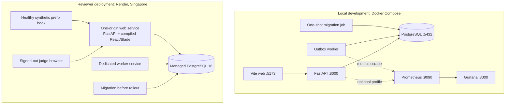

The deployment image uses pinned base/runtime artifacts, a non-root application
user, locked dependency installs, and a production frontend build. The M9
deployment runbook describes setup, billing requirements, UptimeRobot, signed
out checks, screenshots and rollback. Local rehearsal is not the same as a
public deployment being active.

See [`docs/DEPLOYMENT.md`](DEPLOYMENT.md) and `infra/render/Dockerfile`.

## 27. Testing and release verification

The repository defines the following release gates:

```bash
make lint           # Ruff + ESLint
make typecheck      # strict mypy + TypeScript
make test           # backend suite + coverage and frontend tests
make test-contract  # generated schemas, fixture/data checks, contract tests
make test-e2e       # Playwright Chromium stories
make build          # production frontend build + bundle budget
make eval           # frozen detector, experiment and model evaluation checks
make security-check # Bandit, repository scan, dependency audits
make observability-check
make failure-matrix
make m8-check
make check          # all implemented release gates
```

Test categories include:

- Pure unit and property tests for contracts, detector, policy and data
  arithmetic.
- Integration tests for webhook ingestion, deduplication, migrations,
  transactional outbox, projection, detection, incident lifecycle, and recovery.
- Contract and deterministic fixture/schema drift tests.
- Security tests for secret/history scans and dependency audit behavior.
- Adversarial detector, analyst grounding/privacy/injection and failure cases.
- Database race tests for approval/idempotency and provider-execution state.
- Frontend component/accessibility states and three Chromium user stories.
- Versioned evaluation commands, whose row/case counts are not added to pytest
  counts.
- One external Razorpay Test Mode receipt, which is a bounded integration proof
  and not a test-count multiplier.

The project operating contract requires commands to be reported only when
actually run. This overview did not run the release suite; use current CI and
`docs/TESTING.md` for exact verification evidence and conditions.

### Release verification pipeline

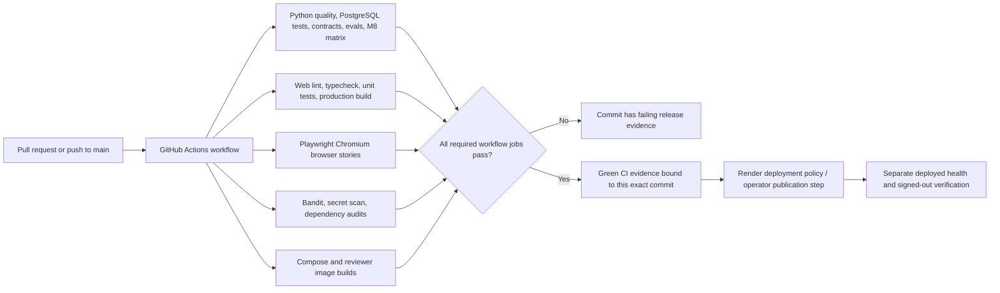

The diagram separates automated build evidence from publication and live
health checks. A passing build alone does not establish that a public reviewer
deployment or video is available.

## 28. Known limitations and future work

### Current limitations

- Single configured merchant and shared-secret browser/API demo authentication;
  no production IAM, RBAC, revocation workflow or row-level isolation.
- Synthetic benchmark and deterministic outcome data do not prove live
  merchant conversion, financial impact, or model quality on real operations.
- Test Mode provider proof is one approved link, not an execution-scale or
  production reliability study.
- Recovery template currently demonstrates a single standard Payment Link
  path, with notifications disabled.
- The model provider is optional, separately enabled, and not required for the
  product's core path. Live-data governance is out of scope.
- The M9 package has locally rehearsed infrastructure, but the documented
  external deployment/repository/video publication steps remain pending.

### Product requirement backlog

The product requirements identify later work such as stricter multi-merchant
tenant isolation, low/medium/high-value policy presets, evidence and receipt
exports, read-only MCP incident tools, configurable detector thresholds and
cohort dimensions, and optional alternative recovery channels after verified
consent and P0 completion. Infrastructure extensions (for example a Go edge
or Kafka adapter) are explicitly deferred until core release gates are met.

## 29. Buildathon mapping and demo narrative

| Track 3 expectation | RetryRail implementation/evidence |
| --- | --- |
| Detect revenue at risk | Qualified statistical cohort detector and at-risk incident evidence |
| Choose a relevant intervention | Cited deterministic brief plus optional grounded proposal constrained to one known template |
| Execute bounded recovery | Full preview, 13-rule policy, one-time external merchant approval, execute-once Test Mode or simulated fake |
| Measure money across a batch | Frozen treatment/control experiment and incremental GMV report with uncertainty |
| Compliant escalation | Merchant scope, consent, amount/currency and approval constraints |
| Stopping rules | Attempt cap, cooldown, expiry, opt-out, already-recovered checks and kill switch |
| Audit trail | Append-only policy/approval/action/dispatch/provider receipts and completeness verifier |
| Architecture | System map, trust boundaries, typed contracts and decision records |
| Public repository/video | M9 operator publication and final recording tasks remain separate pending gates |

### Five-minute story outline

The repository checklist recommends a concise, live product story:

```text
0:00–0:25  Merchant problem and promise
0:25–0:50  Show the control room and evidence-first distinction
0:50–1:20  Advance deterministic traffic and detect a cohort incident
1:20–1:55  Inspect evidence, impact, hypotheses and unknowns
1:55–2:25  Show grounded analysis and deterministic fallback
2:25–3:05  Review policy, stop conditions, and merchant decision
3:05–3:35  Explain the constrained Test Mode receipt (no secrets shown)
3:35–4:00  Show duplicate/ambiguous-timeout handling and lookup-only recovery
4:00–4:25  Explain treatment/control incremental GMV and uncertainty
4:25–4:40  Close on architecture, complete audit and synthetic/Test Mode limits
```

The final video itself is marked pending in the project status/checklist. This
outline is not a claim that a recording or public URL exists.

## 30. Key source files and evidence index

### Start with the authoritative documents

- `AGENTS.md` — collaboration, privacy, scope, engineering and release rules.
- `docs/PRODUCT_REQUIREMENTS.md` — authoritative product behavior and
  acceptance contract.
- `docs/BUILD_PLAN.md` — authoritative sequencing, milestones and release gates.
- `docs/PROJECT_STATUS.md` — dated implementation boundary and verification
  handoff.
- `docs/BUILDATHON_REQUIREMENTS_TRACEABILITY.md` — official track mapping and
  claim-to-artifact route.
- `docs/ARCHITECTURE.md` and `docs/adr/` — component and trust decisions.
- `docs/TESTING.md` and `docs/SUBMISSION_CHECKLIST.md` — verification and
  remaining publication tasks.

### Evidence files

- `evals/blind/detector_v4/runs/detector_v4_official_blind_5497598109b06d21c625/blind.report.v1.json`
- `evals/blind/detector_v4/runs/detector_v4_official_blind_5497598109b06d21c625/blind.release.v1.json`
- `evals/reports/recovery_experiment_v1.report.json`
- `evals/reports/razorpay_test_mode_receipt.v1.json`
- `evals/reports/incident_analyst_bakeoff.v1.json`
- `evals/golden/detector_v4.freeze.json`, `detector_v4.candidate.json`, and
  `detector_v4.blind_procedure.freeze.json`
- `evals/protocols/detector_v4.protocol.json`
- `evals/experiments/recovery_v1/protocol.json` and
  `assignment.freeze.json`
- `docs/assets/retryrail-system-map.svg`, `control-room-overview.png`,
  `experiment-impact.png`, and `recovery-policy-review.png`

### Useful source entry points

- App composition: `services/api/app/retryrail/main.py`
- Webhook: `api/webhooks.py`, `webhooks/signatures.py`, `events/ingestion.py`
- Worker/projector: `worker.py`, `events/outbox.py`, `events/projector.py`
- Detection: `detection/engine.py`, `detection/service.py`, `detection/v4_*`
- Policy: `policy/engine.py`
- Recovery routes/workflow/execution/providers: `api/recovery.py`,
  `recovery/workflow.py`, `recovery/execution.py`, `recovery/adapter.py`,
  `recovery/audit.py`
- Analyst: `recovery/analysis.py`, `incident_analyst.py`, `openai_analyst.py`
- Experiment: `experiments/models.py`, `experiments/service.py`,
  `experiments/evaluation.py`
- Database: `db/tables.py`, `migrations/versions/`
- Web: `apps/web/src/pages/`, `apps/web/src/api/retryrail.ts`
- Local and reviewer runtime: `docker-compose.yml`, `render.yaml`,
  `infra/render/Dockerfile`

---

**Claim discipline:** Treat the README, versioned schemas, exact run receipts,
evaluation protocols, CI commit links, current `docs/PROJECT_STATUS.md`, and
`docs/PRODUCT_REQUIREMENTS.md` as the sources of truth for any future summary.
Keep synthetic results visibly synthetic, keep the provider proof labeled Test
Mode, and preserve the separation between detection, model explanation,
deterministic policy, merchant approval, and execution.
